### Hey, Muffek here 👾

FiveM developer from Poland. I write scripts and in-game interfaces for roleplay servers - Lua on the client and server side, Vue or React for the NUI.

#### 🔧 Things I work on

* 🧱 Custom FiveM resources from scratch - standalone or built on ESX / QBCore / Qbox
* 🖼️ Modern NUI - phones, tablets, HUDs and menus in Vue / React
* 🛡️ Rewriting old scripts - server-side validation, closing exploits and event abuse
* 💾 Database design with oxmysql - inventories, economies and player data
* 🚀 Optimization - lightweight code that keeps the server smooth with a full player count

#### 📦 Toolbox

